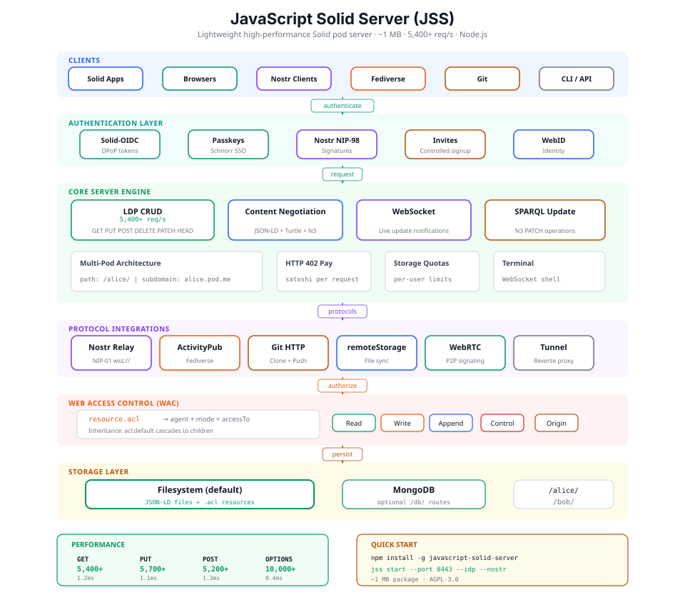

# JavaScript Solid Server

[](https://www.npmjs.com/package/javascript-solid-server)

A minimal, fast, JSON-LD native Solid server for the agentic web.

**[Documentation](https://javascriptsolidserver.github.io/docs/)** | **[GitHub](https://github.com/JavaScriptSolidServer/JavaScriptSolidServer)**

## Contents

- [Architecture](#architecture)
- [Features](#features)
- [Quick Start](#quick-start)
- [Installing with Podman](#installing-with-podman)
- [Running with Podman](#running-with-podman)
- [CLI Reference](#cli-reference)
- [Documentation](#documentation)
- [Comparison](#comparison)
- [Performance](#performance)
- [Running Tests](#running-tests)
- [Maintainers](#maintainers)
- [License](#license)

## Architecture

<p align="center">
  
</p>

## Features

- **LDP CRUD** — GET, PUT, POST, DELETE, HEAD, PATCH (N3 + SPARQL Update)
- **JSON-LD Native** — Stores and serves JSON-LD by default, Turtle via `--conneg`
- **Web Access Control** — `.acl` file-based authorization
- **Solid-OIDC** — Built-in Identity Provider with DPoP, passkeys, Schnorr SSO
- **Programmatic Auth** — `POST /idp/credentials` issues tokens from email/password; agents and headless clients authenticate with no browser flow
- **WebSocket Notifications** — Real-time updates (solid-0.1 protocol)
- **Content Negotiation** — Turtle ↔ JSON-LD conversion (optional)
- **Multi-user Pods** — Path-based (`/alice/`) or subdomain-based (`alice.example.com`)
- **Single-User Mode** — Personal pod server with `--single-user`
- **Git HTTP Backend** — Clone and push to pod containers
- **Nostr Relay** — Integrated NIP-01 relay (`wss://your.pod/relay`)
- **Nostr Auth** — NIP-98 signatures, did:nostr → WebID resolution
- **End-to-End Encryption** — Encrypt pod content client-side via NIP-44 / NIP-04 using `did:nostr` keys ([docs](https://jss.live/docs/features/e2ee/), zero server-side changes)
- **LWS / CID v1 profile shape** — New pod profiles are structurally W3C [Controlled Identifier](https://www.w3.org/TR/cid-1.0/) documents, ready for [LWS 1.0](https://www.w3.org/TR/2026/WD-lws10-authn-ssi-cid-20260423/) auth ([docs](docs/lws.md))
- **ActivityPub** — Fediverse federation with Mastodon-compatible API
- **remoteStorage** — [draft-dejong-remotestorage-22](https://remotestorage.io/spec/) file sync
- **MongoDB Storage** — Optional `/db/` route for JSON-LD at scale
- **WebRTC Signaling** — Peer-to-peer connections via WebID-authenticated signaling
- **Tunnel Proxy** — Decentralized ngrok through your pod
- **Terminal** — WebSocket shell access via `--terminal`
- **Password CLI** — `jss passwd` for user password management
- **MCP Server** — Expose the pod as a tool surface for agents (Claude Desktop, Cursor, custom bots) via `--mcp` ([docs](docs/mcp.md))
- **HTTP 402 Payments** — Monetize endpoints with per-request sat payments
- **Mashlib / SolidOS UI** — Optional data browser (CDN, local, or ES module)
- **Storage Quotas** — Per-user limits with CLI management
- **Invite-Only Mode** — Controlled registration via invite codes
- **SSL/TLS, CORS, Range Requests, Conditional Requests**

## Quick Start

```bash
# Install
npm install -g javascript-solid-server

# Start
jss start

# With common options
jss start --port 8443 --idp --mashlib --conneg --git --nostr
```

### Creating a Pod

```bash
curl -X POST http://localhost:4443/.pods \
  -H "Content-Type: application/json" \
  -d '{"name": "alice"}'
```

### Using the Pod

```bash
# Read
curl http://localhost:4443/alice/public/

# Write
curl -X PUT http://localhost:4443/alice/public/data.json \
  -H "Authorization: Bearer YOUR_TOKEN" \
  -H "Content-Type: application/ld+json" \
  -d '{"@id": "#data", "http://example.org/value": 42}'
```

### Android/Termux

```bash
pkg install nodejs git
npm install -g javascript-solid-server
jss start --port 8080 --nostr --git
```

## Installing with Podman

These steps install Podman and the helper tools used to run JSS in a Podman pod
(with a `Makefile`, a `jss.yaml` pod spec and helper scripts, all in the
[`podman/`](podman/) folder). Podman isolates the JSS from your host system and Podman Pods can be orchestrated with Kubernetes.

You need Podman, `make`, and `curl`, `jq` and `openssl` for the helper
scripts. Then run everything from the `podman/` folder of this repo (see
[Running](#running-with-podman)). Only Ubuntu has been tested here; the macOS and Windows
steps follow Podman's standard setup and are untested.

### Ubuntu

```bash
sudo apt install -y podman make curl jq openssl
```

### Linux Mint

Linux Mint 21 and 22 are based on Ubuntu, so it's the same:

```bash
sudo apt install -y podman make curl jq openssl
```

Mint 22 (Ubuntu 24.04 base) ships Podman 4.9, which has everything used here
(`podman kube play --replace --publish`, `podman kube down`). Mint 21 (Ubuntu
22.04 base) ships Podman 3.4, which is too old; upgrade to Mint 22 or install a
newer Podman from the [Podman install page](https://podman.io/docs/installation).

Rootless Podman needs your user in `/etc/subuid` and `/etc/subgid`; normal
Mint accounts already are. Check with:

```bash
grep "^$USER:" /etc/subuid /etc/subgid
```

### macOS

Podman runs containers in a small Linux VM on macOS. With
[Homebrew](https://brew.sh/):

```bash
xcode-select --install
```

```bash
brew install podman jq
```

```bash
podman machine init && podman machine start
```

`xcode-select --install` provides `make` (`curl` and `openssl` are built in).
Published ports such as `127.0.0.1:4443` are forwarded from the VM to your Mac,
so <http://localhost:4443/> works as on Linux. Keep your Podman setup under your home
folder, which the VM can see. The `jss-data` and `jss-secrets` volumes live
inside the VM, so on-disk volume paths are
Linux-only. After a reboot, run `podman machine start` before `make up`.
[Podman Desktop](https://podman-desktop.io/) is a graphical alternative to the
`brew` install. For HTTPS, `brew install caddy`.

### Windows

The simplest route is WSL 2 with Ubuntu, then the Ubuntu steps inside it. In
PowerShell as administrator:

```powershell
wsl --install -d Ubuntu
```

Restart if asked, open the **Ubuntu** app, and run:

```bash
sudo apt update && sudo apt install -y podman make curl jq openssl
```

Keep your Podman setup inside the Ubuntu home folder (for example `~/git/`), not under
`/mnt/c/`, and run the `make` commands from there. WSL forwards `localhost`,
so <http://localhost:4443/> opens from your Windows browser.

Alternatively, install Podman for Windows (it also runs on WSL 2) with
`winget install -e --id RedHat.Podman` or [Podman Desktop](https://podman-desktop.io/),
then `podman machine init` and `podman machine start` (again after each
reboot). From PowerShell you can then use the commands in
[Running without make](#running-without-make), but the `Makefile` and the
`create-pod`/`grant-webid` scripts need bash (WSL or Git Bash). For HTTPS,
`winget install -e --id CaddyServer.Caddy`, or install Caddy inside WSL.

## Running with Podman

Run `make` and the `podman` commands below from the `podman/` folder of this
repo, which contains `jss.yaml` and the `Makefile`. They use relative paths such
as `jss/`, `profiles/` and `jss.yaml`, so they fail from anywhere else.

| Path (under `podman/`) | Purpose |
| --- | --- |
| `jss/Containerfile` | Image: Node 22 + `javascript-solid-server` (pinned via `JSS_VERSION`) |
| `jss.yaml` | Kubernetes v1 Pod run with `podman kube play` (volumes `jss-data`, `jss-secrets`) |
| `profiles/local.yaml` | ConfigMap for `http://localhost:4443/` |
| `profiles/lan.yaml` | ConfigMap for LAN access (`0.0.0.0:4443`) |
| `profiles/internet.yaml` | ConfigMap for a public HTTPS domain behind Caddy, invite-only |
| `profiles/*.local.yaml` | Your machine-specific copies of the profiles (gitignored, used automatically) |
| `proxy/Caddyfile` | Host-side Caddy reverse proxy (internet site, LAN `tls internal` example) |
| `scripts/create-pod.sh` | Create a pod with a generated password, saving the login outside the repo |
| `scripts/grant-webid.sh` | Grant a WebID access to a container, keeping existing ACL rules |
| `Makefile` | Build / run / inspect / reset commands |

### With make

| Command | What it does |
| --- | --- |
| `make up` | Build the image and start the pod (`PROFILE=local` by default) |
| `make up PROFILE=lan` | Same, with the `lan` profile, published on `0.0.0.0:4443` |
| `make up PROFILE=internet` | Same, with the `internet` profile, on `127.0.0.1:4443` behind Caddy |
| `make down` | Stop and remove the pod (volumes are kept) |
| `make restart` | `down` then `up` |
| `make logs` | Follow server logs |
| `make status` | Show pod, container, and volume state |
| `make shell` | Shell inside the server container (e.g. for `jss invite create`) |
| `make rebuild` | Rebuild the image without cache, then restart |
| `make reset` | Stop the pod and, after confirmation, delete all data and secrets |
| `make caddy-validate` | Check `proxy/Caddyfile` in a throwaway Caddy container |
| `make create-pod NAME=…` | Create a pod (account) and save its login to `~/.config/jss-dev/<name>-account.txt` |
| `make grant-webid POD=… CONTAINER=… WEBID=…` | Give a WebID Read/Write/Control on a container |

Pass the same `PROFILE=` to `restart` and `rebuild` that you used for `up`.

### Running without make

Without make, the equivalents are `podman kube play --replace --configmap profiles/local.yaml --publish 127.0.0.1:4443:4443 jss.yaml` to start and `podman kube down jss.yaml` to stop.
Build the image first with `podman build -t localhost/jss:latest jss`
(`make up` does this for you). For another profile, use
`profiles/<name>.yaml` (or your `profiles/<name>.local.yaml`) and its bind:
`--publish 0.0.0.0:4443:4443` for `lan`, `--publish 127.0.0.1:4443:4443` for
`local` and `internet`.

### Is it running?

With make:

```bash
make status
```

The `jss` pod should show `Running` and `jss-server` should show `Up`, with
`127.0.0.1:4443->4443/tcp` (or `0.0.0.0:4443` on the `lan` profile). `Exited`
or no pod at all means it's stopped. `make logs` follows the server log.

Without make:

```bash
podman pod ps
```

```bash
podman ps --all --filter name=jss-server
```

Look for `Running` (pod) and `Up …` (container); `Exited` means it stopped.
Follow the log with:

```bash
podman logs -f jss-server
```

Either way, check that it answers HTTP:

```bash
curl -s -o /dev/null -w '%{http_code}\n' http://localhost:4443/
```

`200` means it's up; `000` means nothing is listening on port 4443. You can
also open <http://localhost:4443/> in a browser.

The pod doesn't start again by itself after a reboot (rootless Podman doesn't
start pods at boot unless you set that up), so after restarting the machine,
run `make up` again. Your data is kept in the `jss-data` and `jss-secrets`
volumes.

## CLI Reference

```bash
jss start [options]    # Start the server
jss init [options]     # Initialize configuration
jss invite <cmd>       # Manage invite codes
jss quota <cmd>        # Manage storage quotas
jss passwd <username>  # Manage user passwords
```

Key options: `--port`, `--idp`, `--conneg`, `--mashlib`, `--git`, `--nostr`, `--mcp`, `--activitypub`, `--webrtc`, `--tunnel`, `--terminal`, `--mongo`, `--pay`, `--public`, `--single-user`

Full options: [docs/configuration.md](docs/configuration.md)

## Documentation

| Topic | Link |
|-------|------|
| Configuration & Options | [docs/configuration.md](docs/configuration.md) |
| Authentication | [docs/authentication.md](docs/authentication.md) |
| Mashlib / SolidOS UI | [docs/mashlib.md](docs/mashlib.md) |
| WebSocket Notifications | [docs/notifications.md](docs/notifications.md) |
| Git Support | [docs/git-support.md](docs/git-support.md) |
| Installing Apps | [docs/app-install.md](docs/app-install.md) |
| MCP (pod as agent tool surface) | [docs/mcp.md](docs/mcp.md) |
| Nostr Relay | [docs/nostr.md](docs/nostr.md) |
| ActivityPub & Mastodon API | [docs/activitypub.md](docs/activitypub.md) |
| remoteStorage | [docs/remotestorage.md](docs/remotestorage.md) |
| WebRTC & Tunnel | [docs/webrtc.md](docs/webrtc.md) |
| Terminal & Password CLI | [docs/terminal.md](docs/terminal.md) |
| MongoDB `/db/` Route | [docs/mongodb.md](docs/mongodb.md) |
| HTTP 402 Payments | [docs/payments.md](docs/payments.md) |
| Storage Quotas | [docs/quotas.md](docs/quotas.md) |
| Invite-Only Registration | [docs/invites.md](docs/invites.md) |
| Security & Subdomain Mode | [docs/security.md](docs/security.md) |
| Architecture & Structure | [docs/architecture.md](docs/architecture.md) |

## Comparison

| Server | Package | Packages | node_modules |
|--------|---------|----------|-------------|
| [JSS](https://github.com/JavaScriptSolidServer/JavaScriptSolidServer) | ~1 MB | ~191 | ~77 MB |
| [CSS](https://github.com/CommunitySolidServer/CommunitySolidServer) | ~6 MB | ~311 | ~152 MB |
| [Pivot](https://github.com/solid-contrib/pivot) | ~6 MB | ~311+ | ~152 MB |
| [NSS](https://github.com/nodeSolidServer/node-solid-server) | ~7 MB | ~670 | ~539 MB |

## Performance

| Operation | Requests/sec | Avg Latency | p99 Latency |
|-----------|-------------|-------------|-------------|
| GET resource | 5,400+ | 1.2ms | 3ms |
| GET container | 4,700+ | 1.6ms | 3ms |
| PUT (write) | 5,700+ | 1.1ms | 2ms |
| POST (create) | 5,200+ | 1.3ms | 3ms |
| OPTIONS | 10,000+ | 0.4ms | 1ms |

## Running Tests

```bash
npm test
```

## Maintainers

JSS is maintained by [@melvincarvalho](https://github.com/melvincarvalho) and [@jjohare](https://github.com/jjohare). See [MAINTAINERS.md](MAINTAINERS.md).

## License

Licensed under [AGPL-3.0](./LICENSE).
Commercial licensing also available — see [LICENSING.md](./LICENSING.md).
